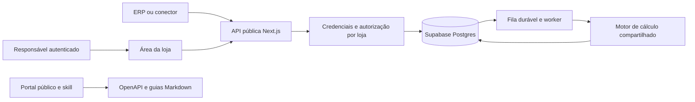

# Raio X de Margem da Loja fase 2

SPEC e plano de implementação da API de integração com ERPs e da documentação pública para pessoas e agentes de IA.

Data: 14/10/2026. Status: proposta para implementação futura. Base: [plano.md](plano.md), especialmente seções 6, 7, 9, 11, 12 e 16. Este documento não autoriza implementação, provisionamento ou publicação.

## 1 Objetivo e resultado esperado

Permitir que qualquer ERP implemente uma integração por um contrato público comum: enviar e atualizar o catálogo autorizado de uma loja, solicitar análises de margem e consultar produtos, resultados e alterações. O integrador não depende de exportação manual de CSV nem de conhecimento do banco interno.

A fase 2 entrega também documentação pública organizada, `openapi.json`, `llms.txt` e uma skill para download e uso em Claude Code, Codex, OpenCode e outras ferramentas compatíveis com Agent Skills. Desenvolvimento com IA é um requisito explícito do produto: humanos e agentes devem conseguir construir uma integração completa usando os mesmos contratos e exemplos.

“Qualquer ERP” significa acesso ao mesmo protocolo HTTP/JSON, sem exclusividade de fornecedor. Cada ERP ainda precisa desenvolver ou configurar seu conector e obter autorização da loja. Não significa conexão automática a qualquer sistema existente.

## 2 Evolução em relação à fase 1

| Tema | Fase 1 | Proposta para fase 2 |
|---|---|---|
| Catálogo | Somente em memória no navegador | Persistido para lojas que ativarem integração |
| Identidade | Sessão anônima | Conta responsável, loja e integração autorizada |
| Entrada de dados | CSV local | CSV local e API autenticada em jornadas distintas |
| Cálculos | Determinísticos no navegador | Mesmo motor determinístico executável no servidor |
| Histórico | Sem catálogo ou relatório recuperável | Análises persistidas e consultáveis pela loja e ERP autorizado |
| API | Endpoints internos para lead, eventos e IA | Contrato público versionado e documentado |
| Privacidade | Contato e agregados opcionais | Autorização adicional para catálogo e análises da integração |
| Infraestrutura | SQLite local; Supabase na publicação | Postgres compartilhado obrigatório para a integração |

A fase 1 pode continuar sendo desenvolvida e validada com seu escopo atual. A API pública usará `/api/v1`, sem transformar os endpoints anônimos existentes em endpoints de parceiros. Os contratos atuais de `lib/contracts.ts` são referência inicial, não garantia de que a implementação da fase 1 já esteja concluída.

O catálogo importado anonimamente não será enviado ao servidor automaticamente. A ativação de integração terá explicação própria sobre armazenamento e acesso. Leads e autorizações comerciais não serão expostos aos ERPs nem convertidos em contas por coincidência de email.

## 3 Escopo da primeira liberação

### Entregas obrigatórias

- Conta e área mínima para o responsável criar uma loja, autorizar uma integração, emitir, rotacionar e revogar credenciais.
- API REST/JSON para carga e atualização de produtos, inativação, consulta paginada e sincronização incremental.
- Análise determinística do catálogo persistido, com cenário, resultados por produto, resumo e versão do cálculo.
- Consulta autenticada das análises e visualização do catálogo integrado no dashboard.
- Isolamento entre lojas, escopos de credenciais, idempotência, controle de concorrência, limites e auditoria.
- Ambiente de testes com dados fictícios e credenciais próprias.
- Portal público de documentação, OpenAPI, arquivos para LLMs e skill portável para download.

### Evolução posterior

Webhooks, OAuth para marketplace de parceiros, várias fontes escrevendo na mesma loja, integrações prontas com fornecedores, SDKs oficiais, estoque, vendas, tributação, alteração automática de preço e processamento de catálogos maiores que o limite do piloto ficam fora da primeira liberação.

IA interpretativa continua recebendo apenas agregados conforme a fase 1. A primeira API pública retorna cálculos determinísticos; gerar diagnósticos com IA pela API será extensão própria, com quota e contrato adicionais. Consultar análises de margem não consome uma geração de IA.

## 4 Jornadas e autorização

### Responsável pela loja

1. Cria conta com contato verificado e uma loja, ou aceita um convite verificável para uma loja existente.
2. Ativa a integração após conhecer os dados armazenados, finalidades, acesso e retenção.
3. Identifica o ERP e cria uma conexão de origem. Na primeira liberação, cada loja tem uma única origem ativa de escrita.
4. Escolhe os escopos e emite uma chave, exibida uma única vez, para configurar no backend ou conector do ERP.
5. Visualiza última sincronização, erros, análises, credenciais e opção de desconectar ou excluir os dados.

### ERP ou agente que implementa o conector

1. Consulta a documentação sem login; instala a skill se desejar.
2. Usa sandbox para validar autenticação, mapeamento de IDs, envio, análise e consulta.
3. Configura chave de produção e loja autorizada no servidor do conector.
4. Faz a carga inicial em lotes, depois envia mudanças com versões crescentes.
5. Solicita análises e recupera resultados; acompanha alterações por cursor.
6. Trata erros e retoma a sincronização sem duplicar produtos ou análises.

A API não poderá cadastrar uma loja ou acessar seu catálogo apenas com CNPJ, email ou um ID informado pelo ERP. Associação a uma conta exige um fluxo autorizado. O identificador técnico da loja não precisa ser seu CNPJ.

## 5 Identidade e isolamento

Proposta: Supabase Auth para a conta humana e credenciais de API próprias para chamadas entre sistemas. Não usar a sessão anônima da fase 1 como identidade da integração.

Modelo mínimo: uma organização pode possuir várias lojas; cada membro tem papel `owner` ou `viewer`. Somente `owner` administra integração e acesso. Cada chave de API pertence a uma loja, origem, ambiente e conjunto de escopos, sem poderes administrativos sobre membros.

Escopos: `products:read`, `products:write`, `analyses:read` e `analyses:write`. A consulta incremental de produtos exige `products:read`. Credenciais somente de leitura são suportadas. A conexão de escrita única pode coexistir com chaves de leitura e com duas chaves temporárias da mesma origem durante rotação.

Todo endpoint deve verificar credencial, ambiente, loja e escopo antes de buscar ou alterar o recurso. Tentativas de acessar recurso de outra loja retornam `404`. UUID não é autorização. Todas as queries, índices únicos e relacionamentos de dados da integração devem preservar a loja correspondente.

Chave opaca com alta entropia, prefixo identificável e validade inicial de 90 dias. Guardar identificador e hash de verificação, nunca o segredo recuperável. Rotação cria outra chave; sobreposição máxima proposta de 24 horas. Revogação impede novas chamadas imediatamente, sem depender de token em cache. Operações já confirmadas podem concluir; o encerramento definitivo da conexão cancela trabalhos ainda não iniciados.

Credenciais ficam em `Authorization: Bearer <chave>`, somente por HTTPS. Não em query strings, código frontend, arquivos versionados ou documentação. Emissão e revogação usam a sessão humana autenticada, com proteção adequada contra CSRF. A API de integração não usa cookies nem precisa permitir chamadas com chave no navegador.

## 6 Contrato público de produtos

Proposta de recursos em `camelCase`, coerente com a fase 1. IDs externos e códigos são strings. Moeda inicial única: BRL. Datas UTC em RFC 3339. Valores monetários são inteiros em centavos; percentuais em pontos-base. Não aceitar formatação monetária de CSV nos campos JSON.

| Campo de entrada | Obrigatório | Regra |
|---|---|---|
| `externalId` | Sim | ID estável do produto no ERP, 1–100 caracteres, sensível a maiúsculas, sem espaços externos |
| `sourceVersion` | Sim | Inteiro positivo e seguro em JSON; crescente por produto, persistido pelo conector |
| `name` | Sim | Texto não vazio, até 200 caracteres |
| `barcode` | Não | String até 100 caracteres ou `null`, preservando zeros |
| `purchaseCostCents` | Sim | Inteiro de 0 a 100.000.000 |
| `salePriceCents` | Sim | Inteiro de 1 a 100.000.000 |
| `active` | Sim | Booleano; `false` inativa sem apagar o histórico |
| `sourceUpdatedAt` | Não | Data da origem; informativa, não usada para resolver concorrência |

Campos de resposta adicionais: `id`, `storeId`, `sourceId`, `revision`, `createdAt`, `updatedAt` e `alerts`. O servidor define esses campos; o ERP não escolhe a loja efetiva por um campo do corpo.

Identidade única: `(storeId, sourceId, externalId)`. Código de barras duplicado gera alerta, sem fusão; nomes iguais são permitidos. Variações ou serviços com preço próprio usam IDs externos distintos. A origem é determinada pela chave, e `sourceRow` não integra o contrato público: era rastreabilidade de arquivo.

Atualização substitui os campos de entrada completos, não é um PATCH implícito. `barcode` omitido normaliza para `null`. O schema rejeita campos desconhecidos na v1 para detectar erros de mapeamento. Campo obrigatório ausente não preserva silenciosamente um valor antigo. Custo ausente não vira zero; custo zero e custo maior que venda mantêm os alertas da fase 1.

O ERP é a autoridade sobre nome, código, custo, preço e atividade. O projeto é a autoridade sobre cálculos, alertas e análises. Simulação não altera preço cadastrado nem envia uma alteração de preço ao ERP. Troca de origem requer procedimento explícito de remapeamento e novo bootstrap, sem associar produtos automaticamente por barcode.

## 7 Catálogo de endpoints

Prefixo em cada ambiente: `/api/v1`. IDs presentes no caminho sempre são verificados contra a chave.

| Método e caminho | Uso | Escopo e resposta de sucesso |
|---|---|---|
| `GET /me` | Identificar loja, origem, ambiente, escopos e limites da chave | Chave válida; `200` |
| `POST /stores/{storeId}/product-batches` | Criar ou atualizar lote completo de produtos | `products:write`; `200`, resultado por item |
| `GET /stores/{storeId}/products` | Bootstrap paginado do catálogo em um snapshot | `products:read`; `200` |
| `GET /stores/{storeId}/products/{productId}` | Recuperar produto, inclusive inativo | `products:read`; `200` |
| `GET /stores/{storeId}/product-changes` | Consultar alterações após cursor | `products:read`; `200` |
| `POST /stores/{storeId}/analyses` | Capturar catálogo e solicitar cálculo de cenário | `analyses:write`; `202` com `Location` |
| `GET /stores/{storeId}/analyses` | Listar metadados de análises | `analyses:read`; `200` |
| `GET /stores/{storeId}/analyses/{analysisId}` | Status, cenário e resumo da análise | `analyses:read`; `200` |
| `GET /stores/{storeId}/analyses/{analysisId}/items` | Resultados paginados por produto do snapshot | `analyses:read`; `200` |

Quem cria uma análise deve conseguir consultar seu status; o portal emite `analyses:write` junto com `analyses:read`. Listagem padrão: `limit=100`, máximo 500, cursor opaco e ordenação documentada. Resposta de lista: `data`, `nextCursor` e metadados pertinentes; fim indicado por `nextCursor: null`. Não usar paginação por offset na sincronização.

Inativação e reativação usam o lote com `active` e uma versão nova. Ausência de um produto em um lote não significa exclusão. Não oferecer remoção física individual na API inicial; exclusão integral da loja é um fluxo do responsável.

## 8 Lotes, idempotência e conflitos

Limites propostos: até 500 produtos e 1 MB por lote, até 5.000 produtos ativos por loja no piloto. JSON UTF-8; rejeitar excesso com `413` antes de processamento completo. Produto repetido por `externalId` no mesmo lote invalida o pedido.

Cada lote é atômico: validar todos os itens antes de confirmar. Um item inválido retorna `422` com índice e campo; nenhum item é escrito. Um conflito de versão retorna `409`, também sem escrita parcial. O conector corrige ou divide o lote e envia uma nova operação. Nenhum lote substitui o catálogo inteiro.

Comparação transacional de `sourceVersion` por produto:

- Maior que a versão armazenada: aplicar alteração.
- Igual com conteúdo normalizado idêntico: `unchanged`, sem nova revisão ou evento.
- Igual com conteúdo diferente: conflito.
- Menor: conflito de atualização antiga; nunca sobrescrever a atual.

O conector mantém esse contador de forma durável, mesmo após reiniciar. Pode derivá-lo de revisão confiável da origem; timestamps de relógios diferentes não são um substituto silencioso.

`Idempotency-Key` é obrigatório em ambos os POSTs. Escopo da chave: loja + origem + método + caminho + chave. Rotacionar a credencial da mesma origem não muda o escopo. Normalizar o pedido e comparar hash; mesma chave e corpo retornam a resposta original, sem nova escrita ou análise. Corpo diferente retorna `409`. Retenção: sete dias. Operação concorrente ainda em curso retorna `409` com código `idempotency_in_progress` e orientação de retry.

Gravação, revisão, log de mudanças e confirmação de idempotência devem estar na mesma transação. A criação de análise captura snapshot, cria job e registra idempotência atomicamente. Após expirar a chave, versões protegem produtos, mas uma nova solicitação de análise pode criar outro resultado: o conector precisa respeitar a janela documentada.

## 9 Sincronização e recuperação

Carga inicial do ERP: enviar todo o catálogo em lotes, conferir respostas e só então solicitar a primeira análise. Os lotes são operações independentes: uma análise captura exatamente o estado confirmado quando solicitada, não promete atomicidade entre vários lotes. Não inferir que a carga está completa apenas porque um lote terminou.

Para buscar dados do projeto, `GET /products` abre um snapshot temporário consistente, com `snapshotId`, `asOfRevision`, `nextCursor` e `changesCursor`. Páginas seguintes usam o cursor para ler o mesmo snapshot. Duração proposta: 30 minutos; cópia temporária expirada é eliminada. O conector inicia o feed incremental pelo `changesCursor` retornado, incluindo alterações ocorridas enquanto paginava.

Cada mudança confirmada recebe revisão monotônica por loja e inclui `productId`, `externalId`, `sourceVersion`, `revision`, `operation`, `changedAt` e o estado do produto naquela revisão. `operation` será `upsert` ou `deactivate`. Reativação é `upsert`. O conector salva o cursor só depois de aplicar a página recebida; eventos podem ser reaplicados com segurança pela revisão.

A revisão é alocada e as alterações são confirmadas sob serialização por loja, para impedir commits fora da ordem de leitura. Não usar apenas horário, UUID ou uma sequence sem garantir ordem de confirmação como cursor de sincronização.

Feed retido por 90 dias. Cursor expirado retorna `410` com código `sync_cursor_expired`; o conector faz novo bootstrap. Cursor de outra loja, ambiente ou filtros é inválido. Catálogo inativo continua consultável; snapshots e análises não desaparecem por simples inativação de produto.

## 10 Análises e regras de cálculo

Pedido com `scenario`: `discountBps`, `targetBps`, `feeBps` e `feeEnabled`, nos limites da fase 1. Com `feeEnabled=false`, exigir `feeBps=0`. Reusar o motor puro de cálculo da fase 1, incluindo arredondamento, preço simulado zero e percentual `null`. Não duplicar a fórmula dentro dos handlers.

O servidor captura todos os produtos ativos da loja em um snapshot imutável, calcula a partir desses valores e guarda cenário, `catalogRevision`, `calculationVersion`, `createdAt`, resumo, alertas e resultados por item. Desempate do ranking usa `externalId` e `id` com ordenação fixa, pois não existe linha de CSV.

Estado: `queued` → `running` → `completed` ou `failed`. Pedido retorna `202`, `analysisId` e URL de acompanhamento. Catálogo sem produto ativo retorna `422`, sem criar job. Mudanças posteriores no catálogo não alteram uma análise pronta. A resposta informa explicitamente qual revisão foi utilizada e não se apresenta como catálogo atual.

Resumo mantém contagens e faixas da fase 1. `invalidCount` da análise será zero, pois entradas inválidas foram rejeitadas; erros de importação ficam nos resultados de lote. Preservar a distinção entre margem bruta estimada e contribuição estimada, sem afirmar lucro líquido ou impacto total da loja.

Meta inicial: concluir análise de 5.000 produtos em até 30 segundos no piloto, a validar por carga. Não prometer SLA antes dessa medição. Fila durável em Postgres, worker com lease, heartbeat, limite de tentativas e recuperação de trabalho interrompido. Retentativa técnica reutiliza o mesmo snapshot e resultado, sem outra análise. Não iniciar tarefa longa apenas com uma Promise solta após a resposta de uma Function.

O dashboard autenticado usa o catálogo integrado e as análises da loja. A jornada de CSV anônima continua com seus parâmetros e regras próprios; o vínculo de conta não autoriza enviar arquivos anteriores.

## 11 Exemplos de contrato

Envio de um lote; IDs abaixo são ilustrativos:

```http
POST /api/v1/stores/store_demo/product-batches
Authorization: Bearer <chave-do-ambiente>
Idempotency-Key: catalogo-lote-0001
Content-Type: application/json
```

```json
{
  "products": [
    {
      "externalId": "SKU-001",
      "sourceVersion": 1,
      "name": "Camiseta",
      "barcode": "0012345678905",
      "purchaseCostCents": 6000,
      "salePriceCents": 10000,
      "active": true
    }
  ]
}
```

Resposta `200` com `data` contendo `externalId`, `id`, `status` (`created`, `updated` ou `unchanged`), `sourceVersion` e `revision` de cada item. Após atualizar, usar a mesma chave apenas para repetir exatamente aquele pedido; outra mudança exige outra chave e versão.

Pedido de análise:

```json
{
  "scenario": {
    "discountBps": 1000,
    "targetBps": 2000,
    "feeBps": 1000,
    "feeEnabled": true
  }
}
```

O produto do exemplo deve retornar preço simulado de 9.000 centavos, taxa de 900 e contribuição de 2.100, equivalente a aproximadamente 23,33%. O contrato entrega percentuais sem arredondamento de apresentação e usa `null` quando não aplicáveis; dinheiro sempre permanece inteiro.

## 12 Erros e limites operacionais

Erros no formato Problem Details da [RFC 9457](https://www.rfc-editor.org/info/rfc9457/), com `Content-Type: application/problem+json`, `type`, `title`, `status`, `detail`, `instance` e extensões `code`, `requestId` e `errors`. Não incluir token, nome de produto ou payload completo na mensagem de erro. `errors` identifica índice, campo e motivo.

| HTTP | Caso e tratamento do conector |
|---|---|
| `400` | JSON ou cursor inválido; corrigir pedido |
| `401` | Chave inválida, expirada ou revogada; corrigir autenticação |
| `403` | Escopo ausente; revisar autorização |
| `404` | Recurso inexistente ou inacessível à loja |
| `409` | Versão, idempotência ou operação concorrente; verificar código antes de repetir |
| `410` | Cursor ou snapshot expirado; recomeçar bootstrap |
| `413` | Corpo ou lote acima do limite; dividir |
| `422` | Schema, valores ou catálogo vazio; corrigir campos |
| `429` | Quota atingida; respeitar `Retry-After` |
| `503` | Serviço temporariamente indisponível; retry limitado |

Limites iniciais compartilhados por loja, não multiplicáveis criando chaves: 120 consultas/minuto, 20 lotes/minuto, 5 novas análises/hora e 20/dia. Cada análise consome quota só uma vez; replay idempotente não consome outra. Limites globais de custo e tamanho serão configuráveis e medidos no piloto.

Retries para falha de rede, `429` e `503`: backoff exponencial com jitter, até cinco tentativas na execução, respeitando `Retry-After`. Manter a mesma chave idempotente em retries. Depois, registrar falha recuperável e retomar pelo cursor ou estado salvo; não repetir indefinidamente. Polling de análise começa em dois segundos e cresce até dez, encerrando em estado terminal ou timeout local configurável.

Logs: identificadores técnicos, ambiente, status, duração e contagens; sem chave, contato, corpo de produto ou diagnóstico completo. Métricas por loja e ambiente: taxa de sucesso, latência, lotes rejeitados, conflitos, filas, falhas de análise e última sincronização. Auditoria de emissão/revogação e autorização com ator e horário.

## 13 Arquitetura e modelo de dados



Manter Next.js/Vercel e Supabase/Postgres como base. A implementação futura escolhe o executor do worker conforme duração e custos medidos, preservando fila durável e processamento recuperável. SQLite pode continuar na fase 1 local, mas não é critério de aceite de isolamento ou concorrência da API da fase 2.

| Entidade proposta | Responsabilidade |
|---|---|
| `organizations`, `stores`, `memberships` | Organização, lojas e vínculo autorizado das contas |
| `integration_sources` | ERP identificado, loja, ambiente e estado da conexão |
| `api_credentials` | Hash, prefixo, loja, origem, escopos, expiração e revogação |
| `integration_products` | Dados atuais, versão da origem, revisão e atividade |
| `product_changes` | Feed ordenado com estado em cada revisão |
| `catalog_read_snapshots` e itens | Bootstrap consistente, temporário e paginado |
| `integration_analyses` e itens | Cenário, snapshot imutável, resultados e versão de cálculo |
| `integration_jobs` | Fila, lease, tentativas e estados de execução |
| `api_idempotency`, `api_limits` | Replay seguro e limites transacionais |
| `integration_audit` | Autorizações e ações técnicas sem conteúdo do catálogo |

Separar essas entidades dos leads, diagnósticos anônimos e quotas da fase 1. Planejar migrações aditivas, índices por loja, unicidades de origem/produto e FKs compostas onde necessário para impedir vínculos cruzados.

Supabase distingue grants de RLS; ambos precisam corresponder ao acesso pretendido. Credenciais privilegiadas ficam somente no servidor e podem contornar RLS, portanto não substituem autorização por loja nos handlers e repositórios. APIs de ERP não expõem a Data API nem entregam chaves do Supabase. [Referência oficial de segurança](https://supabase.com/docs/guides/api/securing-your-api).

Preferir entidades internas em schema não exposto e acesso humano ao catálogo via backend. Onde houver acesso pela Data API, definir grants mínimos e RLS vinculada a memberships verificadas. Não copiar claims editáveis pelo usuário para decisões de autorização. Funções privilegiadas exigem grants restritos, `search_path` controlado e validação de contexto. Testar acesso cruzado inclusive com o caminho privilegiado usado em produção.

## 14 Privacidade e ciclo de vida

Ativação da integração registra responsável, finalidade, origem, versão do aviso e momento da autorização. O cadastro comercial da fase 1 não autoriza persistir catálogo nem compartilhar resultados com ERP.

Proposta operacional: catálogo enquanto a conexão estiver ativa; análises, feed de mudanças e auditoria técnica por 90 dias; idempotência por sete dias; snapshots de leitura por 30 minutos; jobs concluídos por sete dias. Não são prazos legais presumidos. Revisar finalidade e aviso antes da ativação real.

Desconectar revoga as chaves, interrompe entrada de dados e oferece exclusão. Exclusão solicitada elimina catálogo, análises, snapshots e pedidos com conteúdo em até sete dias, com acesso bloqueado desde a solicitação; eventual retenção de metadados mínimos deve ser justificada. Documentar separadamente a janela de backups e restauração. Nenhum dado individual de produto é enviado ao provedor de IA.

## 15 Portal público de documentação

Entrega obrigatória em `/docs/api`, acessível sem cadastro e independente da landing page comercial. Referência de organização: portais de desenvolvedores com início rápido, navegação lateral, busca, referência por recurso e exemplos próximos ao endpoint. A identidade visual deve ser coerente com o produto e priorizar leitura e orientação.

### Estrutura de conteúdo

1. Visão geral e conceitos: loja, origem, produto, análise e ambientes.
2. Início rápido: obter credencial de teste, enviar um produto, criar análise e consultar resultado.
3. Autenticação, escopos, revogação e rotação.
4. Modelos de dados, dinheiro, pontos-base, versões e alertas.
5. Referência de todos os endpoints, schemas e respostas.
6. Sincronização completa e incremental, retomada e conflitos.
7. Análises, snapshots, estados e limitações de interpretação.
8. Erros, quotas, idempotência e retries.
9. Integração com IA: OpenAPI, `llms.txt`, skill e instalação por ferramenta.
10. Sandbox, suporte, changelog e política de versões.

### Experiência e acessibilidade

- Navegação lateral persistente no desktop, recolhível no celular; breadcrumb e índice da página.
- Busca em guias e operações por nome, caminho, campo e código de erro.
- Cada operação exibe método, caminho, `operationId`, escopos, parâmetros, schema, exemplo e respostas de erro reais.
- Blocos copiáveis com exemplos em cURL, TypeScript e Python, incluindo versões de runtime usadas na validação.
- Ambiente e versão sempre visíveis; tema claro/escuro, teclado, contraste e leitura adequada no celular.
- Links diretos por seção e endpoint; botões para baixar OpenAPI e skill e copiar a URL do `llms.txt`.
- Conteúdo principal renderizado no servidor ou estático, sem exigir JavaScript para leitura por agentes.
- Console interativo opcional, somente sandbox na primeira entrega. Sem chave de produção persistida no browser ou enviada a analytics; nunca disparar chamadas automaticamente.

Proposta de ferramenta: renderer de referência compatível com OpenAPI 3.1 integrado a guias Markdown no Next.js. Avaliar alternativas como Scalar e Swagger UI ao implementar, pelas necessidades de acessibilidade e integração. A SPEC não depende de um fornecedor de documentação.

## 16 OpenAPI e documentação para LLMs

Fonte canônica do contrato: OpenAPI 3.1.1 versionado no repositório, conforme a [especificação OpenAPI](https://spec.openapis.org/oas/v3.1.1.html). Guias e runtime devem ser verificados contra esse contrato; não manter três versões manuais divergentes de endpoints.

Publicar `/openapi.json` como alias da versão corrente e `/docs/api/v1/openapi.json` como contrato da v1. Incluir `info.version`, ambientes em `servers`, Bearer auth em `securitySchemes`, segurança por operação, `operationId` único e estável, schemas completos, limites, enumerações, nulabilidade, paginação, erros e exemplos fictícios. Como Bearer opaco não é OAuth, declarar os escopos exigidos em descrição e extensão `x-required-scopes`, sem fingir um fluxo OAuth.

Downloads públicos retornam `200`, MIME correto, ETag e cache revalidável; nenhum contrato exige chave para leitura. Permitir leitura cross-origin desses artefatos públicos quando necessário, sem abrir CORS da API privada. Validar referências, exemplos e contrato na CI; mudanças incompatíveis exigem v2.

Arquivo canônico para LLMs: `/llms.txt`, em minúsculas e plural, seguindo a [proposta llms.txt](https://llmstxt.org/). Atender também o nome pedido `LLM.txt` com aliases `/LLM.txt` e `/llm.txt` para o canônico. Não substituir `llms.txt` por um nome que agentes não descubram.

Conteúdo: nome e resumo do produto, domínio canônico, versão, distinção sandbox/produção, invariantes de dinheiro e autorização, links para início rápido, contrato, recursos, sincronização, erros e skill. Manter índice curto, com links absolutos para documentos Markdown completos. Disponibilizar versões `.md` dos guias, sem navegação HTML, e `/llms-full.txt` como compilação opcional versionada do conteúdo público.

Documentação HTML aponta versões Markdown com `rel="alternate"` e o índice com `rel="describedby"`. OpenAPI, portal, Markdown, `llms.txt` e skill devem ser gerados ou publicados pelo mesmo processo de release, identificando a mesma versão. Não incluir dados de clientes ou segredos em nenhum artefato público.

`llms.txt` oferece descoberta e contexto; ele não concede acesso à API. O agente precisa das mesmas credenciais, escopos e limites de qualquer integrador.

## 17 Skill pública para integração com IA

A documentação disponibilizará uma skill utilizável, não apenas um artigo sobre como escrever uma. Nome proposto: `raio-x-margem-api`. Formato aberto [Agent Skills](https://agentskills.io/specification), com `SKILL.md`, frontmatter YAML `name` e `description`, referências relativas e instruções sem dependência obrigatória de MCP, plugin pago ou ferramenta exclusiva de uma plataforma.

Pacote futuro:

```text
raio-x-margem-api/
  SKILL.md
  references/
    api-contract.md
    synchronization.md
    errors-and-retries.md
    examples.md
  assets/
    openapi.json
  LICENSE
```

`api-contract.md` descreve versão, escopos e aponta para o OpenAPI incluído; não duplica todo o schema. Os demais arquivos ajudam em tarefas específicas. Licença de distribuição e domínio público devem estar definidos antes do download final. Nenhum placeholder de ambiente real permanece no pacote publicado.

Publicar ZIP com pasta de raiz correta em `/downloads/raio-x-margem-api-skill.zip`, cópia por release com versão no nome, SHA-256, tamanho, versão do contrato e instruções de instalação na página. Publicar também `SKILL.md` como texto em `/docs/api/skill/SKILL.md`, acessível sem login. O ZIP inclui todo o contexto necessário para trabalhar sem depender da interface visual do portal.

### Conteúdo obrigatório da skill

- Quando usar: construir, revisar e depurar conectores para esta API, no projeto e linguagem escolhidos pelo usuário.
- Como localizar o contrato incluído, conferir sua versão contra o contrato publicado e usar `operationId` e schemas reais.
- Como obter ambiente, loja, origem e credenciais por configuração segura, sem pedir que o usuário cole segredos em texto público.
- Como mapear IDs externos, preservar zeros, converter moeda para centavos e percentuais para pontos-base.
- Como enviar lotes atômicos, manter `sourceVersion`, gerar e persistir idempotência e lidar com conflitos.
- Como fazer bootstrap, feed incremental, salvar cursor, recuperar expiração e consultar análises imutáveis.
- Como validar em sandbox, limitar retries e registrar informações de diagnóstico sem payloads sensíveis.
- Respeitar o escopo autorizado: construir um conector não autoriza modificar dados de produção. Exemplos e scripts não realizam escrita ao serem lidos ou instalados.
- Resultado esperado: integração adequada à stack do usuário, configuração documentada e evidência do fluxo real em sandbox.

Não exigir uma linguagem única nem reescrever o projeto inteiro. A skill deve orientar decisões específicas desta API e consultar referências conforme a necessidade, mantendo seu arquivo de entrada curto. Scripts auxiliares só serão incluídos se agregarem execução repetível e forem testados; não são requisito para usar a skill.

### Instalação e portabilidade

| Ferramenta | Instalação no projeto |
|---|---|
| Claude Code | `.claude/skills/raio-x-margem-api/SKILL.md` com os arquivos irmãos |
| Codex | `.agents/skills/raio-x-margem-api/SKILL.md` com os arquivos irmãos |
| OpenCode | `.opencode/skills/raio-x-margem-api/SKILL.md` com os arquivos irmãos; suporta também caminhos compatíveis de agentes |

Os caminhos devem ser conferidos a cada release nas documentações oficiais de [Claude Code](https://code.claude.com/docs/en/skills), [Codex](https://learn.chatgpt.com/docs/build-skills) e [OpenCode](https://opencode.ai/docs/skills/). Documentar instalação global e em ambientes cloud quando suportada: uma pasta local de usuário não é automaticamente transferida para uma sessão remota. Distribuir o mesmo núcleo de skill nas três ferramentas, sem impor frontmatter exclusivo de uma delas.

“100% compatível com desenvolvimento com IA” será critério de entrega do fluxo documentado nas ferramentas e versões testadas, não uma promessa sobre todo modelo ou ambiente futuro. Outras ferramentas que leem Markdown/OpenAPI podem usar os mesmos arquivos; instalação nativa de skill depende de suporte ao formato.

## 18 Ambiente de testes e versionamento

Sandbox com URL, dados, chaves e quotas próprias; nenhuma chave de sandbox funciona em produção. Preferir projeto Postgres separado para que erros de ambiente não alcancem dados reais. Dados sintéticos e rotina de reset documentada. O início rápido usa esse ambiente e termina com um resultado calculado verificável.

API pública evolui em `/api/v1`; versão de release do contrato é independente da versão do aplicativo. Campos novos de resposta são aditivos e os consumidores devem tolerá-los. Remover campo, mudar unidade, tornar obrigatório campo antes opcional ou mudar semântica exige nova versão principal.

Política proposta: aviso de descontinuação por pelo menos 90 dias, com guia de migração e sinalização no portal. Skill versionada indica contrato compatível; pacote da v1 continua disponível durante sua janela de suporte. Não alterar silenciosamente exemplos públicos para APIs ainda não liberadas.

## 19 Plano de execução futuro

Não há dependência de alterar a landing page que está sendo feita em outra sessão. As entregas abaixo pertencem à fase 2 e só começam quando solicitadas.

| Ordem | Entrega | Dependência e conclusão verificável | Esforço inicial |
|---|---|---|---|
| 1 | Revisar fase 1 concluída e fechar contratos da v1 | Motor de cálculo identificado; OpenAPI e exemplos revisados | 2–3 dias |
| 2 | Conta, loja, autorização e credenciais | Isolamento, rotação, revogação e administração mínima testados | 3–5 dias |
| 3 | Produtos, lotes e persistência | Validação, unicidade, transações e idempotência funcionando | 3–5 dias |
| 4 | Bootstrap e feed incremental | Concorrência, snapshot consistente e retomada verificados | 2–4 dias |
| 5 | Análises, fila e dashboard integrado | Snapshot imutável e paridade de cálculos confirmados | 3–5 dias |
| 6 | Portal público e artefatos para agentes | Referência, guias, OpenAPI, arquivos LLM e skill publicados em teste | 3–5 dias |
| 7 | Sandbox, segurança, carga e piloto | Dois conectores distintos passam no fluxo completo | 3–5 dias |
| 8 | Preparação da liberação | Operação, privacidade, suporte e rollback prontos | 1–2 dias |

Estimativa: 20–34 dias de trabalho para uma pessoa experiente, incluindo documentação e validação; recalibrar após revisar o código real da fase 1. Não é uma extensão de quatro horas. A implementação de conectores comerciais pelos parceiros tem esforço próprio.

### Dependências e entregáveis de cada marco

1. **Contrato:** OpenAPI válido, guia de invariantes, exemplos e decisões de ambiente. A definição vem antes de handlers ou skill final.
2. **Fundação:** migrações aditivas, membership, credenciais, repositórios por loja e limites transacionais. Revisar uso de secrets e RLS antes de expor dados.
3. **Dados:** endpoints de catálogo e testes de duplicidade, concorrência e retry. Nenhuma alteração automática de preço.
4. **Resultados:** processamento durável, estados, snapshots e dashboard. Falha do worker precisa ser recuperável.
5. **Experiência de integração:** documentação e contrato na mesma release, download da skill, instalação por ferramenta e sandbox utilizável sem suporte individual.
6. **Liberação:** guia de operação, métricas, backup/restauração, exclusão e teste com parceiros. Publicação em produção depende de instrução futura; não faz parte deste pedido de planejamento.

## 20 Critérios de aceite

| Verificação | Resultado obrigatório |
|---|---|
| Enviar produto com barcode `0012345678905` | Código preservado e dinheiro validado em centavos |
| Enviar custo ausente, venda zero ou versão inválida | `422`, com campo/índice e nenhuma escrita no lote |
| Barcodes iguais em IDs externos distintos | Produtos distintos, alerta, sem deduplicação |
| Repetir lote com mesma chave e corpo | Mesma resposta, sem escrita, revisão ou cobrança de quota extra |
| Reutilizar chave com corpo diferente | `409`, sem efeitos |
| Rotacionar chave e repetir operação da mesma origem | Replay correto no mesmo escopo de idempotência |
| Duas atualizações concorrentes ou fora de ordem | Versão antiga não sobrescreve nova; feed permanece ordenado por commit |
| Inativar e reativar produto | Mudanças recuperáveis no feed; histórico anterior intacto |
| Paginar bootstrap enquanto chegam mudanças | Snapshot estável; transição ao feed sem perder alteração |
| Usar cursor expirado | `410` e orientação para novo bootstrap |
| Chave da loja A consulta produto/análise da loja B | Nenhum dado exposto, incluindo no caminho privilegiado |
| Revogar chave ou usar chave em ambiente errado | Novas chamadas recusadas |
| Custo 6.000, venda 10.000, desconto e taxa 1.000 bps | Preço 9.000, taxa 900, contribuição 2.100 e cerca de 23,33% |
| Atualizar catálogo depois de criar análise | Resultado corresponde ao snapshot e à versão informados |
| Preço simulado arredonda para zero | Percentual `null`, sem divisão por zero |
| Worker interrompido | Recuperação do mesmo job, sem análise duplicada |
| Exceder limites | `429` e `Retry-After`, quota compartilhada por loja |
| Abrir documentação sem login no desktop e celular | Busca, navegação, exemplos copiáveis e leitura acessível |
| Buscar `/openapi.json` sem login | JSON válido, completo, versionado e fiel ao runtime |
| Buscar `/llms.txt`, `/LLM.txt` e `/llm.txt` | Canônico descoberto; links públicos válidos para guias e skill |
| Baixar skill | ZIP completo, hash publicado, referências relativas válidas e versão explícita |
| Usar skill nas três ferramentas | Descoberta e execução do fluxo de sandbox nas versões registradas |
| Dar somente `llms.txt` a um agente | Ele encontra contrato e constrói o fluxo sem inventar endpoints ou unidades |
| Ler logs e artefatos públicos | Nenhum segredo, contato ou catálogo de cliente |
| Usar fase 1 anônima após liberar fase 2 | Fluxo de CSV e consentimentos permanece funcional |

Verificação futura: testes do motor compartilhado; contrato do runtime contra OpenAPI; integração com Postgres real para transações, isolamento e cursor; recuperação do worker; fluxo ponta a ponta em sandbox. A avaliação de agentes deve pedir autenticação, envio, retry, análise e consulta a partir dos artefatos publicados, registrando ferramenta, versão, resultado e intervenções necessárias.

## 21 Pendências para implementar e publicar

Defaults deste plano permitem preparar o contrato sem interromper a fase 1. Antes de implementar, confirmar nome comercial/domínio, público do piloto, tamanho real dos catálogos, executor da fila e meios de verificação da conta. Antes de publicar, configurar responsável de suporte/privacidade, política de retenção, licença da skill e infraestrutura do sandbox.

A habilidade de integrar será validada com dois conectores de estruturas distintas e com Claude Code, Codex e OpenCode. Não abrir acesso geral antes de verificar isolamento, sincronização e coerência da documentação. Reavaliar limites e esforço com os dados do piloto; webhooks e conectores de fornecedores formam incrementos posteriores.

As decisões de limites, arquitetura e prazo são propostas deste planejamento. Consultar novamente as referências oficiais, incluindo o [changelog do Supabase](https://supabase.com/changelog), antes de implementar. Nenhum endpoint, schema, página pública ou pacote instalável foi criado por este documento.
